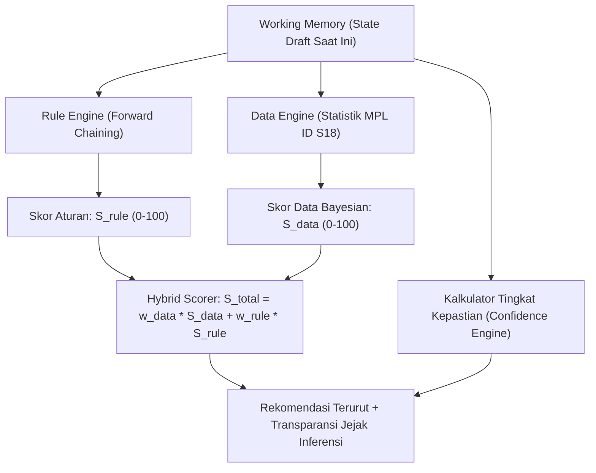

# Spesifikasi Metodologi Mesin Inferensi Hybrid RBR & Bayesian: MetaScout Land of Dawn

Dokumen ini memuat spesifikasi formal arsitektur, basis pengetahuan (*knowledge base*), formulasi matematis, parameter konfigurasi, dan contoh kalkulasi langkah-demi-langkah dari **Mesin Inferensi Rekomendasi Draft Pick MetaScout**. Dokumen ini disusun untuk kebutuhan dokumentasi akademis dan bab metodologi skripsi.

---

## 1. Arsitektur Sistem Hybrid

Sistem rekomendasi draft pick *MetaScout* menggabungkan dua paradigma utama (*hybrid reasoning*):
1. **Data-Driven (Turnamen MPL ID Season 18)**:
   Menggunakan data empiris dari 304 *game* MPL ID Season 18 (sumber: Liquipedia), meliputi *win rate*, *pick rate*, *ban rate*, frekuensi sinergi hero sekutu, dan efektivitas *counter pick* terhadap hero musuh.
2. **Expert-Driven (Rule-Based Reasoning / RBR)**:
   Menggunakan sistem pakar berbasis aturan (*Forward Chaining*) yang dikonfigurasi berdasarkan prinsip *drafting coach* profesional Mobile Legends: Bang Bang (MLBB), meliputi pembagian *power spike*, keseimbangan tipe *damage* (Physical vs Magic), pemenuhan *frontliner*/*durability*, kontrol inisiator *Crowd Control* (CC), dan sinergi varian map.

---

## 2. Working Memory (Representasi State Draft)

Setiap siklus inferensi dimulai dengan pembentukan *Working Memory* $\mathcal{W}$ yang menampung fakta-fakta draft saat ini:

$$\mathcal{W} = \langle \mathcal{A}, \mathcal{E}, \mathcal{B}, \mathcal{D}_{\mathcal{A}}, \mathcal{D}_{\mathcal{E}}, \mathcal{P}_{\mathcal{A}}, \mathcal{P}_{\mathcal{E}}, \mathcal{C}_{\text{frontline}}, \mathcal{C}_{\text{cc}}, \mathcal{M} \rangle$$

Di mana:
- $\mathcal{A}$: Himpunan hero sekutu terpilih ($0 \le |\mathcal{A}| \le 5$).
- $\mathcal{E}$: Himpunan hero musuh terpilih ($0 \le |\mathcal{E}| \le 5$).
- $\mathcal{B}$: Himpunan hero ter-ban ($0 \le |\mathcal{B}| \le 10$).
- $\mathcal{D}_{\mathcal{A}}, \mathcal{D}_{\mathcal{E}}$: Distribusi damage (Physical % vs Magic %) masing-masing tim.
- $\mathcal{P}_{\mathcal{A}}, \mathcal{P}_{\mathcal{E}}$: Distribusi power spike (Early, Mid, Late) masing-masing tim.
- $\mathcal{C}_{\text{frontline}}$: Jumlah hero garis depan (*Tank/Fighter/Roam*).
- $\mathcal{C}_{\text{cc}}$: Jumlah hero dengan inisiasi *Hard Crowd Control* area.
- $\mathcal{M}$: Varian map aktif (*Regular, Bush/Grass, Wisps, dll.*).

---

## 3. Katalog Aturan Sistem Pakar (Rule-Based Reasoning)

| ID Aturan | Nama Aturan | Kondisi Premis (IF) | Konsekuensi & Rekomendasi (THEN) | Bobot ($\beta$) | Kontribusi Skor |
| :--- | :--- | :--- | :--- | :---: | :---: |
| **RBR-COMP-01** | *Mage Mandatory* (Keseimbangan Magic) | Tim sekutu $\ge 3$ hero TANPA Mage/Midlaner atau Magic % $< 15\%$, ATAU $\ge 2$ hero dengan 100% Physical. | Prioritas tertinggi (*Critical*) hero Mage / Magic Damage (*Yve, Pharsa, Valentina, Xavier, Zhuxin*). | 0.98 | +50.0 |
| **RBR-COMP-02** | *Frontline Durability* (Garis Depan) | Tim sekutu $\ge 2$ hero dengan $\mathcal{C}_{\text{frontline}} = 0$. | Prioritas (*Critical*) hero Tank / Fighter pelindung kontes Lord (*Tigreal, Baxia, Hylos, Grock*). | 0.94 | +40.0 |
| **RBR-CTR-01** | *Anti-Dash Suppression* (Anti Assassin) | Tim musuh memiliki Assassin mobilitas tinggi (*Ling, Fanny, Joy, Hayabusa, Nolan*). | Prioritas hero pengunci/anti-dash (*Khufra, Phoveus, Kaja, Franco, Ruby, Minsitthar*). | 0.96 | +35.0 |
| **RBR-CTR-02** | *HP Shredder* (Anti Tank Tebal) | Tim musuh memiliki Tank sustain/HP tebal (*Fredrinn, Baxia, Hylos, Uranus, Gloo*). | Prioritas hero True Damage / % Max HP Shredder (*Karrie, Lunox, Claude, Dyrroth, Alpha*). | 0.91 | +35.0 |
| **RBR-SYN-01** | *Proteksi Hypercarry* (Formasi UBE) | Tim sekutu memiliki Enabler Healer/Support (*Floryn, Angela, Estes, Mathilda*) atau Hard Carry. | Prioritas hero Marksman scaling atau Support pendamping pelindung formasi. | 0.95 | +30.0 |
| **RBR-SYN-02** | *Wombo-Combo CC Area* (AoE Wiping) | Tim sekutu memiliki inisiator CC massal (*Tigreal, Atlas, Carmilla, Terizla, Akai*). | Prioritas hero Burst AoE penyapu (*Pharsa, Kadita, Odette, Claude, Vexana*). | 0.92 | +30.0 |
| **RBR-POW-01** | *Early Snowball Tempo* | Tim sekutu memiliki $\ge 1$ hero Early Game tempo. | Prioritas hero penguasa objektif menit awal (0–5m) untuk invasi jungle & perebutan turret shield. | 0.89 | +25.0 |
| **RBR-POW-02** | *Late Game Macro Scaling* | Tim sekutu memiliki $\ge 1$ hero Late Game scaling. | Prioritas hero pertahanan high-ground dan teamfight 5v5 fase puncak Trinity Marksman (12+m). | 0.90 | +25.0 |
| **RBR-MAP-01** | *Vision & Ambush Map Synergy* | Varian map memuat semak/sungai tambahan (*Wisps / River Grass*). | Prioritas hero *bush ambush* dan pembuka visi area (*Hilda, Novaria, Selena, Grock*). | 0.88 | +20.0 |
| **RBR-GEN-01** | *Turnamen Meta S18 Baseline* | Baseline hero kompetitif MPL ID S18 dengan win rate dan kontestasi tinggi. | Memberikan skor dasar meta turnamen. | 0.85 | +20.0 |

### B. Klasifikasi Identitas Draft (Draft Archetype & Game Plan)
Sistem secara dinamis mengidentifikasi arsitektur draft (*archetype*) untuk masing-masing tim dan merumuskan *Game Plan* (untuk tim sekutu) serta *Counter Strategy* (untuk tim lawan):
1. **AoE Teamfight (Wombo Combo)**: Terbentuk saat tim memiliki $\ge 2$ hero hard CC dan $\ge 1$ hero burst area. *Win condition*: Pertarungan 5v5 terbuka di objektif Turtle/Lord.
2. **Pick-Off & Single Target Ambush**: Terbentuk saat tim memiliki $\ge 2$ hero assassin/single-target lockdown. *Win condition*: Eliminasi cepat core lawan di semi-river jungle sebelum war objektif.
3. **Sustain & Frontline Brawl**: Terbentuk saat tim memiliki $\ge 2$ hero durability/healer. *Win condition*: Pertempuran berkepanjangan (*extended skirmish*) menguras sumber daya musuh.
4. **Poke & High-Ground Siege**: Terbentuk saat tim memiliki $\ge 2$ hero long-range zoning. *Win condition*: Cicil HP lawan dari jarak aman dan eksekusi turret tanpa komit terlalu dalam.
5. **Early Tempo & Jungle Snowball**: Terbentuk saat komposisi didominasi power spike menit 0–5. *Win condition*: Invasi jungle musuh level 1–2 dan akhiri laga sebelum menit 14.
6. **Late-Game Hypercarry Scaling**: Terbentuk saat tim memiliki $\ge 2$ carry scaling menit 12+. *Win condition*: Farming pasif aman di early game hingga carry mengantongi 3-4 core item.
7. **Flex & Balanced Tournament Meta**: Komposisi standar turnamen seimbang dengan distribusi role dan power spike merata.

---

## 4. Formulasi Matematis Pembobotan Hybrid

### A. Smoothing Win Rate Bayesian (Shrinkage)
Untuk mencegah distorsi hero dengan sampel pertandingan sedikit ($n < 10$), win rate dihaluskan menggunakan formula Bayesian Shrinkage:

$$WR_{\text{smoothed}} = \frac{\text{wins} + k \cdot WR_{\text{prior}}}{n + k}$$

Di mana:
- $n$: Jumlah *picks* hero tersebut di MPL ID Season 18.
- $\text{wins}$: Jumlah kemenangan hero tersebut.
- $k$: Parameter kekuatan *prior* ($k = 10$).
- $WR_{\text{prior}}$: Rata-rata win rate turnamen secara global ($0.50$ atau $50\%$).

### B. Data-Driven Score ($S_{\text{data}}$)
Skor data dihitung dari win rate empiris ditambah kontribusi sinergi dan counter:

$$S_{\text{data}} = \min\left(100, \; \left(WR_{\text{smoothed}} \cdot 100 \cdot 1.1\right) + \sum_{s \in \mathcal{S}} \text{bonus}_{\text{syn}}(s) + \sum_{c \in \mathcal{C}} \text{bonus}_{\text{ctr}}(c)\right)$$

Di mana:
- $\text{bonus}_{\text{syn}} = 4.0$ poin per sinergi sekutu yang valid.
- $\text{bonus}_{\text{ctr}} = 5.0$ poin per counter musuh yang valid.
- Jika draft kosong ($|\mathcal{A}| = 0$ dan $|\mathcal{E}| = 0$), komponen sinergi dan counter dinonaktifkan ($0$).

### C. Rule-Based Reasoning Score ($S_{\text{rule}}$)
Skor sistem pakar dihitung dari akumulasi aturan yang menyala (*fired*), dinormalisasi ke skala $0 - 100$:

$$S_{\text{rule}} = \min\left(100, \; \sum_{r \in \mathcal{R}_{\text{fired}}} \left(\text{kontribusi}(r) \cdot \beta_r \cdot \text{match\_factor}(r, h)\right)\right)$$

Di mana:
- $\beta_r$: Bobot keandalan aturan $r \in [0.85, 0.98]$.
- $\text{match\_factor}(r, h)$: Derajat kesesuaian hero kandidat $h$ terhadap aturan $r$ ($1.0$ jika sangat cocok, $0.5$ jika fleksibel, $0.0$ jika tidak sesuai).

### D. Total Hybrid Score ($S_{\text{total}}$)
Skor akhir merupakan kombinasi linear terbobot dari Data Score dan Rule Score:

$$S_{\text{total}} = w_{\text{data}} \cdot S_{\text{data}} + w_{\text{rule}} \cdot S_{\text{rule}}$$

Berdasarkan konfigurasi `config/metascout.php`:
$$w_{\text{data}} = 0.50, \quad w_{\text{rule}} = 0.50$$

---

## 5. Formulasi Tingkat Kepastian (Confidence)

Confidence sistem pakar tidak menggunakan angka statis atau template, melainkan dihitung secara dinamis dari **kekuatan aturan pakar** dan **reliabilitas data turnamen**:

$$\text{Confidence} = w_r \cdot \text{Strength}_{\text{rule}} + w_d \cdot \left(0.55 + 0.45 \cdot \frac{n}{n + k}\right)$$

Di mana:
- $w_r = 0.45$ (bobot sistem pakar), $w_d = 0.55$ (bobot reliabilitas statistik).
- $\text{Strength}_{\text{rule}} = \max_{r \in \mathcal{R}_{\text{fired}}} (\beta_r)$ (kekuatan aturan tertinggi yang menyala).
- $\text{Reliability}_{\text{data}} = \frac{n}{n + k}$ (rasio sampel turnamen MPL ID S18).
- Jika $n < 10$, hero otomatis diberikan flag `"Data terbatas (n<10)"`.

---

## 6. Tabel Parameter Konfigurasi (`config/metascout.php`)

| Nama Parameter | Nilai Default | Penjelasan Metodologis |
| :--- | :---: | :--- |
| `hybrid_weights.data_weight` | `0.50` | Bobot data empiris turnamen MPL ID Season 18. |
| `hybrid_weights.rule_weight` | `0.50` | Bobot penalaran sistem pakar (*coach heuristics*). |
| `bayesian.k_factor` | `10` | Parameter kekuatan prior Bayesian (shrinkage parameter). |
| `bayesian.prior_win_rate` | `0.50` | Nilai prior win rate (50.0%). |
| `thresholds.low_data_threshold` | `10` | Ambang batas sampel kecil penanda flag *data terbatas*. |
| `thresholds.magic_deficit_threshold` | `15.0` | Persentase minimal magic damage sebelum aturan `RBR-COMP-01` terpicu. |

---

## 7. Contoh Kalkulasi Langkah-demi-Langkah (Studi Kasus: Hero Yve)

### Skenario Draft Masukan:
- **Tim Sekutu**: Tigreal (Roam), Bruno (Gold), Ling (Jungle).
  - Rasio Damage: $100\%$ Physical, $0\%$ Magic.
  - Jumlah hero: 3. Belum ada Midlaner / Mage.
- **Tim Musuh**: Pharsa (Mid), Hylos (Roam), Granger (Jungle).
- **Hero Kandidat yang Dievaluasi**: **Yve** (Role: Mage, Lane: Mid Lane, Damage: Magic).

### Langkah 1: Evaluasi Aturan RBR (Forward Chaining)
1. **RBR-COMP-01 (Mage Mandatory)**:
   - Kondisi: Sekutu 3 hero, Magic $0\% < 15\%$, tanpa Mage $\rightarrow$ **FIRED**.
   - Bobot $\beta = 0.98$, Kontribusi = $+50.0$.
   - Yve adalah Mage murni $\rightarrow \text{match\_factor} = 1.0$.
   - Kontribusi: $50.0 \times 0.98 \times 1.0 = 49.00$.
2. **RBR-SYN-02 (Wombo-Combo Area)**:
   - Kondisi: Sekutu memiliki Tigreal (Inisiator CC Area) $\rightarrow$ **FIRED**.
   - Bobot $\beta = 0.92$, Kontribusi = $+30.0$.
   - Yve memiliki ultimate *Real World Manipulation* (AoE Slow/Burst) $\rightarrow \text{match\_factor} = 1.0$.
   - Kontribusi: $30.0 \times 0.92 \times 1.0 = 27.60$.
3. **RBR-GEN-01 (Meta Turnamen)**:
   - Yve adalah hero prioritas Tier S $\rightarrow$ **FIRED** ($+20.0 \times 0.85 = 17.00$).

$$\text{Akumulasi Kontribusi Rule} = 49.00 + 27.60 + 17.00 = 93.60$$
$$S_{\text{rule}} = 93.60$$

### Langkah 2: Evaluasi Data Turnamen MPL ID S18
- Statistik Yve di S18: $n = 23$ game, menang = $18$ kali ($WR = 78.3\%$).
- Bayesian Shrinkage:
  $$WR_{\text{smoothed}} = \frac{18 + (10 \times 0.50)}{23 + 10} = \frac{23}{33} \approx 0.6970 \quad (69.70\%)$$
- Base Data Score: $69.70 \times 1.1 = 76.67$.
- Sinergi dengan Tigreal: $+4.0$.
- Counter terhadap Hylos (Kiting area): $+5.0$.

$$S_{\text{data}} = 76.67 + 4.0 + 5.0 = 85.67$$

### Langkah 3: Perhitungan Total Score
$$S_{\text{total}} = 0.50 \cdot S_{\text{data}} + 0.50 \cdot S_{\text{rule}}$$
$$S_{\text{total}} = (0.50 \times 85.67) + (0.50 \times 93.60) = 42.84 + 46.80 = \mathbf{89.64} \quad (\text{Skala 0–100})$$
*(Tampil pada UI sebagai Tier P1, Skor 89.6 / 100)*.

### Langkah 4: Perhitungan Tingkat Kepastian (Confidence)
- $\text{Strength}_{\text{rule}} = \max(0.98, 0.92, 0.85) = 0.98$.
- $\text{Reliability}_{\text{data}} = \frac{23}{23 + 10} = \frac{23}{33} \approx 0.6970$.
- $\text{Komponen Data} = 0.55 + 0.45 \times 0.6970 = 0.55 + 0.3137 = 0.8637$.
- $\text{Confidence} = (0.45 \times 0.98) + (0.55 \times 0.8637) = 0.4410 + 0.4750 = 0.9160 \rightarrow \mathbf{91.6\%}$.

---

## 8. Integritas dan Keabsahan Akademis
1. **Determinisme dan Auditabilitas**: Seluruh angka probabilitas dan skor diturunkan dari relasi state draft dan database turnamen. Tidak ada nilai acak (*random*) atau teks template statis.
2. **Penanganan Kasus Ekstrem**:
   - Draft kosong ($0$ hero): Tidak mengklaim sinergi/counter palsu; mengevaluasi murni *prioritas baseline meta turnamen*.
   - Hero ter-ban atau terpilih: Langsung dieksklusikan dari himpunan kandidat $\mathcal{K} = \text{AllHeroes} \setminus (\mathcal{A} \cup \mathcal{E} \cup \mathcal{B})$.
